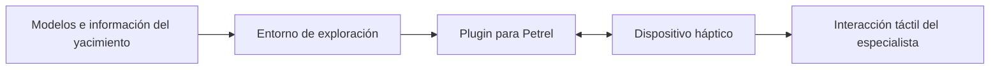

  

  
  
  
  

# Interacción háptica y exploración de yacimientos

**Liderazgo técnico · Ingeniería de hardware y software · Investigación y desarrollo industrial**

Este fue uno de los proyectos con los que inicié mi trayectoria en la industria de hidrocarburos. Participé como **líder técnico e ingeniero de hardware y software** en el desarrollo de una solución para explorar modelos de yacimientos mediante interacción háptica.

El trabajo comenzó en **2015** y evolucionó a lo largo de **tres fases**: desde un prototipo funcional con un dispositivo **Phantom Desktop** hasta un **plugin para Petrel de Schlumberger** que integraba interacción háptica.

También presentamos el proyecto en la **Offshore Technology Conference (OTC)**.

## El desafío

La exploración e interpretación de yacimientos involucra modelos geológicos complejos, información espacial y variables difíciles de analizar mediante una sola representación.

Nos propusimos incorporar **retroalimentación táctil** a la interacción con esos modelos, para ampliar las formas en que un especialista podía explorar e interpretar información del subsuelo.

## De prototipo a producto

| Etapa | Desarrollo |
| :--- | :--- |
| **1. Prototipo funcional** | Construimos una primera solución de interacción háptica utilizando el dispositivo **Phantom Desktop**. |
| **2. Evolución tecnológica** | Trabajamos en la integración y evolución de los componentes de hardware y software. |
| **3. Integración con Petrel** | Culminamos el desarrollo con un **plugin para Petrel**, conectado con un dispositivo háptico. |

El resultado fue una solución especializada que llevó la experimentación inicial a un entorno de software utilizado en la industria energética.

## Tecnología y enfoque de investigación

La solución combinó **hardware de interacción háptica, desarrollo de software e integración con herramientas de modelado de yacimientos**.

El planteamiento de investigación también exploraba la integración de información geográfica, visualización científica tridimensional y métodos probabilísticos para estudiar escenarios de incertidumbre. Esas líneas formaban parte del enfoque del proyecto; no todas corresponden necesariamente a funciones del plugin final.

## Mi participación

Como **líder técnico e ingeniero de hardware y software**, participé directamente en el desarrollo e integración de componentes y en la coordinación técnica de la evolución del proyecto.

Esta experiencia combinó **investigación aplicada, prototipado, ingeniería de sistemas e integración de tecnología especializada**. También marcó el comienzo de mi trabajo posterior con soluciones para la industria Oil & Gas.

## Resultados

- Desarrollo de un **prototipo funcional** con Phantom Desktop.
- Evolución del trabajo a lo largo de **tres fases** de desarrollo.
- Construcción de una solución final integrada como **plugin para Petrel**.
- Presentación del proyecto en la **Offshore Technology Conference**.

## Sobre el proyecto

El desarrollo partió de una iniciativa de investigación e innovación planteada en 2015. Este repositorio presenta mi participación profesional y la evolución tecnológica del proyecto, sin distribuir su código fuente ni materiales internos.

[Más sobre el desarrollo y mi participación](docs/project-context.md).

---

<strong>Investigación aplicada · Ingeniería de hardware y software · Integración tecnológica</strong>

<a href="https://github.com/isaiassolis">Volver a mi portafolio profesional</a>

