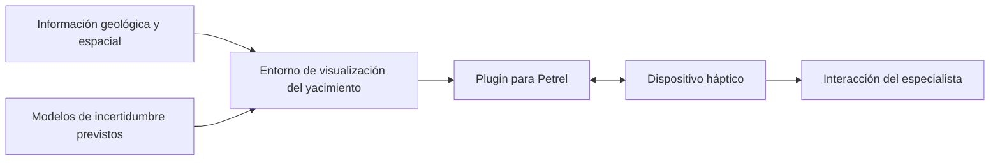

  

  
  
  
  

# Interacción háptica y modelado de incertidumbre en yacimientos

**Liderazgo técnico e ingeniería de hardware y software · Investigación y desarrollo industrial · Proyecto iniciado en 2015**

Este proyecto marcó mi entrada a la industria de hidrocarburos. Participé como **líder técnico e ingeniero de hardware y software** en el desarrollo de una solución para explorar información de yacimientos mediante **interacción háptica**, visualización científica y análisis de incertidumbre.

El proyecto evolucionó a lo largo de **tres fases**: comenzamos con un prototipo utilizando un dispositivo **Phantom Desktop** y culminamos con un producto implementado como **complemento (plugin) para Petrel de Schlumberger**, integrando un dispositivo háptico. También presentamos el proyecto en la **Offshore Technology Conference (OTC)**.

> **Nota de alcance:** la propuesta original de 2015 describe los objetivos y el enfoque tecnológico previsto. Las tres fases ejecutadas, la integración final en Petrel y la presentación en OTC corresponden a mi experiencia directa. Este repositorio no es el código fuente del producto y no reproduce información propietaria.

## 🎯 El desafío

La interpretación de yacimientos no convencionales implica analizar múltiples fuentes de información geológica y espacial, así como escenarios de incertidumbre asociados con factores operativos, ambientales, sociales y económicos.

La idea era **ampliar la experiencia de exploración visual con retroalimentación táctil**, de modo que los especialistas pudieran interactuar con representaciones complejas de los yacimientos y evaluar diferentes condiciones.

## 🚀 De prototipo a producto

| Fase | Evolución documentada desde mi experiencia |
| :--- | :--- |
| **1. Prototipo** | Desarrollamos una primera versión funcional con el dispositivo háptico **Phantom Desktop**. |
| **2. Integración** | Evolucionamos los componentes de hardware y software para su utilización en el entorno de modelado de yacimientos. |
| **3. Producto** | Culminamos con un **plugin integrado en Petrel de Schlumberger**, con interacción mediante dispositivo háptico. |

El proyecto fue presentado en la **OTC**. No indico año, modalidad ni nombre de ponencia porque todavía no están corroborados en la documentación disponible.

## 🧩 Enfoque tecnológico

La propuesta de 2015 contemplaba la convergencia de varias disciplinas:

- **Interacción háptica:** respuesta física para enriquecer la exploración de entornos virtuales.
- **Modelado probabilístico:** inferencia bayesiana aplicada a escenarios de riesgo e incertidumbre.
- **GIS:** integración de capas de información espacial.
- **Visualización científica 3D:** representación de modelos geológicos y de datos del yacimiento.
- **Petrel / Ocean:** entorno de integración de capacidades especializadas mediante complementos.

Estos elementos se mencionan como parte del **planteamiento técnico original**. No afirmo que todos los componentes previstos quedaran implementados exactamente como se propusieron.

## 🧭 Flujo conceptual de la solución

*Diagrama explicativo de alto nivel: no reproduce la arquitectura interna ni el funcionamiento propietario.*

## 👤 Mi participación

Fui **líder técnico e ingeniero de hardware y software**. Mi trabajo combinó desarrollo, integración de componentes tecnológicos y liderazgo durante la evolución del prototipo hacia un producto especializado.

Esta experiencia fue el punto de partida de mi trayectoria posterior en soluciones para la industria energética.

## 📌 Resultado y difusión

- Prototipo funcional inicial con **Phantom Desktop**.
- Desarrollo a través de **tres fases**.
- Producto final como **plugin para Petrel**, con integración háptica.
- Presentación del proyecto en la **Offshore Technology Conference**.

No publico métricas de productividad, cifras comerciales o certificaciones que no estén verificadas.

## 📚 Documentación

- [Contexto, evolución y límites del caso](docs/project-context.md).
- Fuente histórica de referencia: *Interacción háptica y modelado estocástico de incertidumbre en yacimientos no-convencionales* — propuesta de **Proyectos de Estímulos a la Innovación 2015**.

## 🔒 Propiedad intelectual

Este es un **caso de estudio profesional**. No incluyo el documento original de 54 páginas, presupuestos, código, algoritmos, diseños de integración ni materiales comerciales internos. Las marcas **Petrel**, **Schlumberger** y los productos mencionados pertenecen a sus titulares; su mención no implica patrocinio ni afiliación actual.

---

<strong>De la experimentación háptica a una herramienta especializada para la industria energética.</strong>

Caso de estudio profesional de <a href="https://github.com/isaiassolis">Isaías Solís</a>
